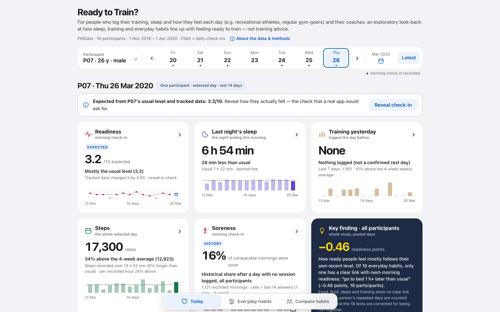
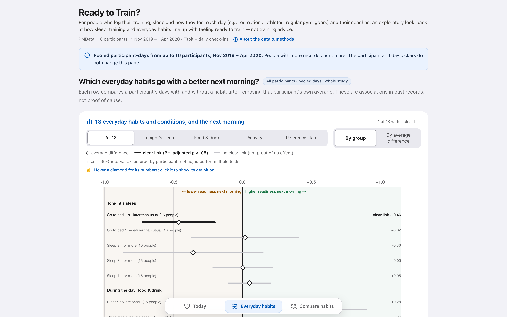

# 训练状态看板 Ready to Train? · Ready to Train? Dashboard

墨尔本大学 GEOM90007 信息可视化课程的个人作业，2026 年 9 月用 R Shiny 完成。得分：待发布。

[English below](#english)



## 这个看板解决什么问题

读者是记录训练、睡眠和每天感受的运动者（比如业余运动员、常去健身房的人）和他们的教练。他们想回看某一天，弄清三件事：

1. 身体状态怎样？
2. 这个判断依据哪些记录？
3. 哪些习惯和第二天状态更好有关？

看板只做回看和探索，不给训练建议，也不是医疗建议。

## 做了什么

- 用公开数据集 PMData：16 名参与者，2019 年 11 月 1 日到 2020 年 4 月 1 日，包括 Fitbit 睡眠、步数、静息心率，晨间自评和训练日志。
- 分三页：
  - **Today**：选一名参与者和一天，六张卡片分别显示自评状态、前一晚睡眠、前一天训练、步数、酸痛和全体的关键发现。先给出按平常水平估计的状态，再点开当天真实的自评。
  - **Everyday habits**：把 18 项习惯和条件分别与第二天的自评状态对比。先减去每个人自己的平均值，置信区间按参与者聚类，多重检验用 BH 校正。
  - **Compare habits**：把这名参与者和其他人比，另用 NHANES 2017～2020 年 3 月的睡眠调查数据作外部参照。
- 每个数字都标明类型：记录值、关联，还是概念演示。每张卡片都写明时间范围。



## 结果

- 16 个日常习惯里，只有“比平时晚睡 1 小时以上”和第二天状态变差有明确关联：平均低 0.46 分（满分 10 分），BH 校正后 p < .05。这是关联，不是因果。
- 加上 Fitbit 和训练记录以后，估计值几乎不变，主要还是跟着每个人自己的平常水平走。看板把这一点直接写了出来。
- 分数发布后补在这里。

## 怎么运行

需要 R 4.x。先装依赖：

```r
install.packages(c("shiny", "ggplot2", "ggiraph", "echarts4r", "bslib",
                   "htmltools", "htmlwidgets", "jsonlite", "scales", "systemfonts"))
```

再在仓库根目录运行：

```r
shiny::runApp("app")
```

2026-10-12 在 R 4.6.1 上重新跑过一次，截图就是这次截的。

`app/` 里是交到 Canvas 的压缩包原样解压的内容，一个文件都没改。压缩包的 SHA-256 是 `d2e1574e96ecb6e3bc467393b119b5df24fd31947c207760756487513c719c5b`。同时提交的设计说明 PDF 含个人信息，没有放进来。

## 数据来源

- PMData：Thambawita et al., *PMData: A Sports Logging Dataset*, ACM MMSys 2020, [doi:10.1145/3339825.3394926](https://doi.org/10.1145/3339825.3394926)，Simula Research Laboratory。数据集官网 2026-09-16 标的是 CC BY 4.0，2020 年的论文写的是 CC BY-NC 4.0。这个仓库是非商业展示，两种许可都允许。参与者已匿名为 P01～P16，`app/` 里只有处理后的 CSV。
- NHANES 2017～2020 年 3 月：美国疾控中心（CDC），公有领域。

## AI 使用说明

应用 “About the data & methods” 页的原文：

> The R code, data preparation and analysis were written with AI coding assistants (OpenAI Codex and Anthropic Claude); the author set the design goals, reviewed every result and decided each iteration and all final design choices.

设计目标、每一轮改什么和最终的设计决定由我负责。R 代码、数据处理和分析由 AI 编码助手编写，`app/app.R` 开头列出了每个版本由哪个助手完成。男女人体图是用 ChatGPT 生成的插图。

## 使用限制

这个仓库用来展示作品，没有开放许可。请不要把它用于课程作业。数据按上面各自的许可使用。

---

## English

A solo assignment for GEOM90007 Information Visualisation at the University of Melbourne, built in R Shiny in September 2026. Mark: not yet released.

### The problem

The audience is people who log their training, sleep and how they feel each day (recreational athletes, regular gym-goers) and their coaches. Looking back at one day, they want to know three things: How is the body today? Which records is that judgement based on? Which habits go with a better next day? The dashboard is an exploratory look-back, not training or medical advice.

### What I built

- Data: the public PMData dataset, 16 participants, 1 November 2019 to 1 April 2020: Fitbit sleep, steps and resting heart rate, morning check-ins and training logs.
- Three pages:
  - **Today**: pick a participant and a day. Six cards show readiness, last night's sleep, yesterday's training, steps, soreness and the study-wide key finding. The dashboard first shows the readiness expected from the person's usual level, then reveals the actual check-in.
  - **Everyday habits**: 18 habits and conditions, each compared with next-morning readiness. Each participant's own average is removed first; intervals are clustered by participant; p-values are BH-adjusted.
  - **Compare habits**: this participant against the others, with NHANES 2017–March 2020 sleep survey data as outside context.
- Every number is tagged as a record, an association or a concept demo, and every card states its time window.

### Result

- Of 16 everyday habits, only "go to bed 1 h+ later than usual" has a clear link with next-morning readiness: 0.46 points lower on a 10-point scale, BH-adjusted p < .05. This is an association, not a cause.
- Adding Fitbit and training data barely changes the expected readiness; it mostly follows each person's own usual level. The dashboard says so.
- The mark will be added here once released.

### Running it

Install the packages listed above in R 4.x, then run `shiny::runApp("app")` from the repository root. Re-run on R 4.6.1 on 12 October 2026; the screenshots come from that run.

`app/` is the submitted ZIP unpacked as is, with no file changed (ZIP SHA-256 above). The design summary PDF submitted with it contains personal details and is not included.

### Data

- PMData: Thambawita et al., *PMData: A Sports Logging Dataset*, ACM MMSys 2020, doi:10.1145/3339825.3394926, Simula Research Laboratory. The dataset website listed CC BY 4.0 on 16 September 2026; the 2020 paper says CC BY-NC 4.0. This repository is a non-commercial portfolio piece, which both allow. Participants are anonymised as P01–P16, and `app/` only contains processed CSVs.
- NHANES 2017–March 2020: US CDC, public domain.

### AI use

Quoted from the app's "About the data & methods" page: "The R code, data preparation and analysis were written with AI coding assistants (OpenAI Codex and Anthropic Claude); the author set the design goals, reviewed every result and decided each iteration and all final design choices." The header of `app/app.R` lists which versions each assistant worked on. The body figures are AI-generated illustrations (ChatGPT image generation).

### Use

Shared as a portfolio piece. There is no open licence; please don't reuse it for coursework. The data stays under the licences listed above.
